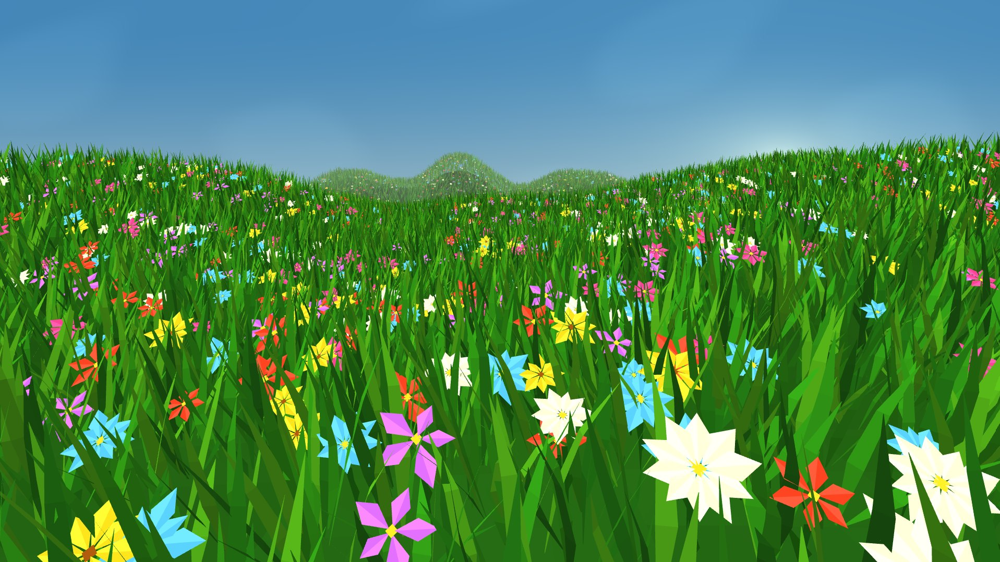

# Meadow3D

Небольшая 3D-сцена цветочной долины на C и OpenGL 3.3. Ландшафт, трава и цветы генерируются программно.

Подробная инструкция по сборке и управлению: [README на русском](README_RU.md).

# Запустить проект
.\meadow3d\build\Release\Meadow3D.exe или открой эту папку в Проводнике и дважды щёлкни Meadow3D.exe.
